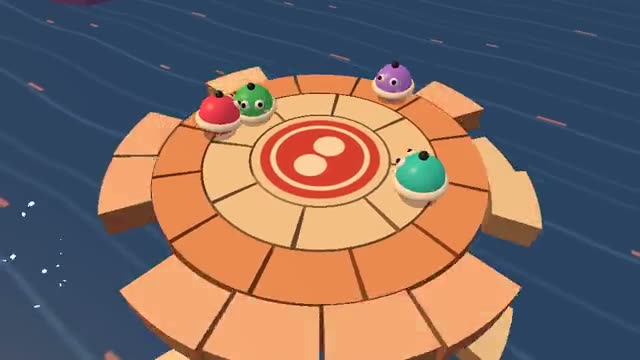

# Sumo Bumpers

Bump everyone off the ring before it crumbles. A multiplayer starter game from [Multiplayer Agent](https://multiplayeragent.com): 3D, party, 2–8 players, with bots that fill empty seats.

## How it plays

Roll your round bumper into the others to knock them into the sea, while the ring falls away from the edge in. Last one on wins the round; first to 3 rounds wins the match.

**Controls:** WASD or arrow keys to roll and Space to dash, or the touch stick and Dash button.

## Make it yours in the Game Builder

Open the [Game Builder](https://multiplayeragent.com), choose **Start from a starter game** and pick Sumo Bumpers. It opens as version 1 in your studio, ready to play and publish. Then ask for changes, for example:

- Make it a pillow fight on a floating bed
- Add a power-up that makes you giant for 5 seconds
- Add ice patches that make you slide further

## Run it yourself

1. Get a free publishable key (`pk_…`) at [multiplayeragent.com](https://multiplayeragent.com).
2. In `index.html`, put it in place of `pk_REPLACE_ME` in the `MP_CONNECT` block.
3. Serve the folder (for example `npx serve`) and open it. The 3D engine loads as a module, which browsers block from a file on disk.

Without a key it still runs, offline against bots.

## How it is built

- One `index.html` plus three.js in `libs/`. The comment at the top of the script maps the code and explains the multiplayer.
- **Host-run physics:** The host's browser works out every bump; if it leaves, the next player takes over.
- **Host-run rounds:** The host counts who fell in and who won; the crumbling ring runs on the round's clock.
- **Bots:** Bots fill the ring until enough people join.
- **Live sync:** Every bumper and every falling piece of the ring is the same for everyone.
- **Leaderboard:** The players who won the most matches, on the results card.
- Every tunable number (speeds, bump strength, how fast the ring falls) is in the `CONFIG` block at the top of the script.
- `?attract` runs it offline with bots only. The preview video is recorded from it.

## License

MIT. three.js in `libs/` is MIT too (Copyright 2010-2024 three.js authors).
